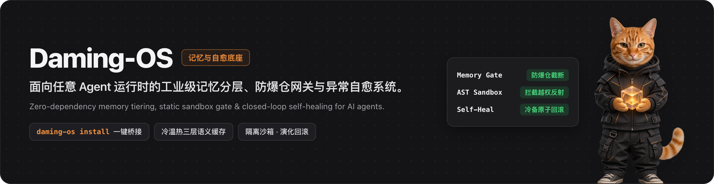
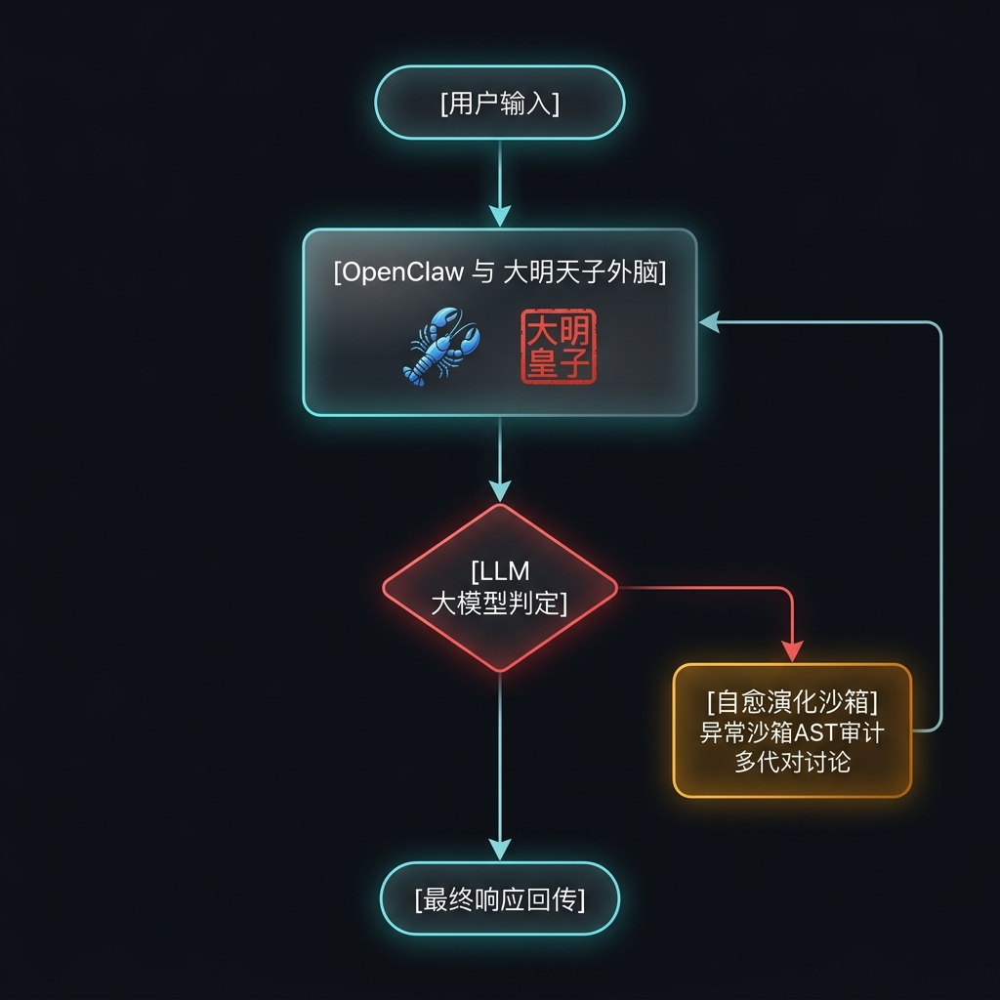

<picture>
  <source media="(prefers-color-scheme: dark)" srcset="assets/banner-dark.png">
  <source media="(prefers-color-scheme: light)" srcset="assets/banner-light.png">
  
</picture>

<div align="center">

<p>
  <a href="README.md"></a>
  <a href="README.zh-CN.md"></a>
  <a href="setup.py"></a>
  <a href="setup.py"></a>
  <a href="LICENSE"></a>
</p>

<p>
  <b>Integrates with</b>&nbsp;
  
  
  
  
  
</p>

[30-Second Quickstart](#30-second-quickstart) · [Architecture Flow](#architecture--closed-loop-flow) · [Runtime Integration](#integrate-any-agent) · [中文文档](README.zh-CN.md)

</div>

---

Autonomous agents running without an operational foundation fail predictably in production — especially inside high-privilege environments:

- **Runaway token bills**: Unbounded context windows grow every turn until API budgets spike or context limits explode.
- **Unchecked self-modification**: Executing agent-generated patches without static auditing exposes the host to privilege escalation and destructive filesystem mutations.
- **Infinite error loops**: Runtime exceptions trap the agent in repetitive self-correction until rate limits or quotas are exhausted.

**Daming-OS** is a **zero-core-dependency, framework-agnostic memory and self-healing foundation** for intelligent agents. Any runtime implementing standard lifecycle, approval, and deployment hooks can attach Daming-OS in minutes — gaining three-tier semantic memory, adaptive context truncation, isolated AST/compile sandboxing, and recoverable evolution with cold-backup rollback.

---

## 30-Second Quickstart

The core package requires **zero third-party runtime dependencies** (`Python >= 3.9`). Install it and scaffold an isolated bridge inside any agent project:

```bash
pip install "daming-os @ git+https://github.com/dylanma8232-art/Daming-OS.git"
daming-os install --host-dir .
```

The installer generates `daming_bootstrap.py`, an isolated `.daming/` workspace, a stable host-bound Agent ID, and `.daming/.gitignore`, then runs an end-to-end **capture → consolidation → recall** smoke test without touching your host's prompt or secret files.

Wire it into your agent in three lines:

```python
from daming_bootstrap import daming

session_id = daming.new_session_id()
ctx = daming.before_turn("Retrieve our previous architecture decision", session_id=session_id)
# Run your model / tool calls here, optionally injecting ctx["daming_memories"]
daming.after_turn("Retrieve our previous architecture decision", "Decision applied.", session_id=session_id)
```

Or register all lifecycle hooks (`before_turn`, `after_turn`, `error`) in one call:

```python
daming.install_hooks(agent.register_hook)
```

---

## Architecture & Closed-Loop Flow

Memory and self-healing in Daming-OS are connected through an event bus and structured audit channels rather than operating as isolated plugins:

<p align="center">
  
</p>

| Pillar | What It Protects Against | How Daming-OS Handles It |
|---|---|---|
| **3-Tier Memory & Adaptive Gateway** | Context bloat & slow retrieval | File-locked two-level hot cache (microsecond reads), hybrid dense + sparse search, tag sanitization, and physical length caps |
| **Static Safety Gate & Sandbox** | Privilege escalation & bad patches | Isolated compile checks, AST static analysis, and smoke tests blocking dangerous imports and reflection writes |
| **Multi-Agent Self-Healing** | Repetitive runtime crash loops | Exponentially decayed failure scoring, red/blue/white deliberation for patch synthesis, and negative-feedback memory persistence |
| **Recoverable Evolution** | Unsafe autonomous updates | Strict `proposed → validated → approved → deployed → verified/rolled_back` state machine with automatic pre-deploy cold backups |
| **Tenant & Secret Governance** | Cross-session leaks & secret exposure | Automatic credential redaction, strict `tenant / agent / session` scoping, and configurable retention policies |

---

## Integrate Any Agent

### 1. Explicit Adapter (`DamingAdapter`)

```python
from daming_os import AgentContext, DamingAdapter

adapter = DamingAdapter()
context = AgentContext(
    agent_id="research-agent",
    session_id="session-42",
    tenant_id="team-a",
    metadata={"trace_id": "trace-123"},
)
memories = adapter.before_turn("Check deployment constraints", context)
# Execute your host's model and tool pipeline
adapter.after_turn("Check deployment constraints", "Constraints verified.", context)
```

Inject your own `validator`, `approvals`, `deployer`, and `verifier` into `EvolutionWorkflow` so chat adapters, webhooks, and release pipelines remain decoupled from Daming-OS.

### 2. Standalone Runtime & Scheduled Maintenance (`DamingRuntime`)

```python
from daming_os import DamingRuntime

runtime = DamingRuntime("./.daming", skill_dirs=["./skills"])
runtime.hooks.install(agent.register_hook)
runtime.start_scheduler(poll_seconds=30)  # Optional: for long-running daemon hosts
```

Default maintenance stays lightweight and deterministic:
- **`daily-maintenance` (02:30)**: Deep-sleep memory consolidation, health checks, and overdue approval reminders (24h cooldown).
- **`weekly-governance` (Sun 23:30)**: Retention cleanup and experience lifecycle review (`pending → verified → deprecated`).
- **Opt-in `daily-digest` & `watchdog`**: Disabled by default so core memory stays lean.

### 3. Optional Semantic Vector Embeddings

Install optional extras (`[vector]`, `[llm]`, `[full]`) only when needed, and connect any OpenAI-compatible embedding endpoint:

```python
from daming_os import OpenAICompatibleEmbeddingProvider
from daming_os.memory.core import MemorySystem

embeddings = OpenAICompatibleEmbeddingProvider(
    model="your-embedding-model",
    base_url="https://your-endpoint/v1",
)
memory = MemorySystem(embedding_provider=embeddings)
```

### 4. Local CLI Approvals & Diagnostics

Approve evolution proposals locally with one-time OTPs (never written to logs) and inspect workspace health at any time:

```bash
daming-os status --dir ./.daming
daming-os doctor --dir ./.daming
daming-os approvals --dir ./.daming list
daming-os approvals --dir ./.daming issue <proposal-id>
daming-os approvals --dir ./.daming approve <proposal-id> <otp>
```

---

## Security Posture

Daming-OS is **fail-open on host availability** (`daming_degraded` flag prevents storage hiccups from crashing your agent, with `DamingPlugin(strict=True)` available for fail-closed environments) and **fail-closed on code evolution** (dangerous imports, reflection mutations, and unapproved self-modifications are blocked by default).

---

## Author

Built by **[Dylan.ma](https://github.com/dylanma8232-art)** · [Explore more open-source tools & experiments →](https://github.com/dylanma8232-art?tab=repositories)

Licensed under [CC BY-NC-SA 4.0](LICENSE).
