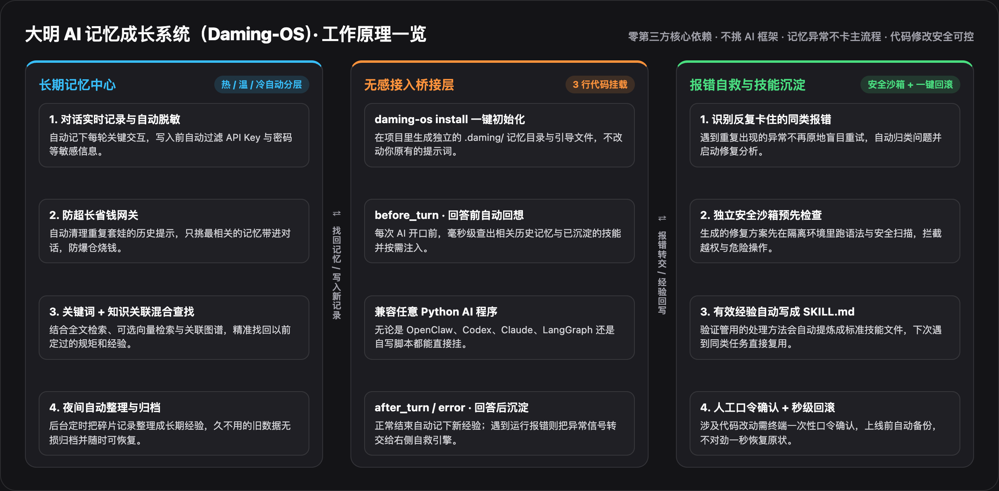

<div align="center">

# 大明 AI 记忆成长系统 (`Daming-OS`)

**让你的 AI 越用越聪明 —— 给任意智能体装上长期记忆、防烧钱预算控制与自动排错自救能力**

<p>
  <a href="README.md"></a>
  <a href="README_EN.md"></a>
  <a href="https://github.com/dylanma8232-art/Daming-OS/releases/latest"></a>
  <a href="setup.py"></a>
  <a href="setup.py"></a>
  <a href="LICENSE"></a>
</p>

<p>
  <b>宿主中立 · 无缝桥接</b>&nbsp;
  
  
  
  
  
</p>

[解决什么问题](#解决什么问题) · [30 秒无侵入接入](#30-秒无侵入接入) · [双闭环架构全景](#双闭环架构全景) · [四种接入模式](#四种接入模式) · [CLI 运维命令速查](#cli-运维命令速查) · [更新日志](CHANGELOG.md)

</div>

---

## 解决什么问题

把自主智能体直接放到真实生产或高权限环境里「裸奔」，通常会撞上三类结构性故障：

- **上下文爆仓与账单失控**：多轮历史、工具回执与嵌套记忆无限膨胀，几轮之后要不撞上上下文窗口上限崩溃，要不把 API 预算烧穿。
- **自修改与动态执行越权**：缺乏独立编译沙箱与静态审计就直接执行 Agent 生成的补丁，极易触发危险导入或文件系统反射篡改。
- **报错死循环与重复踩坑**：遇到运行时异常只会在当前窗口盲目重试，既留不下负反馈教训，也无法把跑通的成功经验沉淀成可复用技能。

**`Daming-OS`** 是一套**核心包零第三方依赖、不绑定任何特定框架**的智能体记忆与自愈运行底座。通过标准生命周期契约（`before_turn` / `after_turn` / `error`），任意 Python Agent 在 1 分钟内即可接入**冷温热三层记忆 + 知识图谱扩散**与**静态沙箱安检 + 冷备回滚自愈**双闭环。

---

## 30 秒无侵入接入

核心包仅依赖 Python 标准库（`Python >= 3.9`）。在现有 Agent 项目根目录执行：

```bash
pip install "daming-os @ git+https://github.com/dylanma8232-art/Daming-OS.git"
daming-os install --host-dir .
```

`install` 命令会在不改动宿主原有 Prompt 与密钥文件的前提下完成四件事：
1. 生成隔离状态目录 `.daming/` 与防隐私泄露的 `.daming/.gitignore`；
2. 绑定宿主专属稳定 `agent_id`；
3. 生成开箱即用的懒加载桥接层 `daming_bootstrap.py`；
4. 现场跑通一次 **「热捕获 → 记忆整合 → 检索召回」** 端到端冒烟自检。

在你的 Agent 主循环中**三行挂载**：

```python
from daming_bootstrap import daming

session_id = daming.new_session_id()
ctx = daming.before_turn("检索上次确认的发布门禁约束", session_id=session_id)
# 运行宿主自身的模型与工具调用，可按需将 ctx["daming_memories"] 注入上下文
daming.after_turn("检索上次确认的发布门禁约束", "已按约束核验通过。", session_id=session_id)
```

若宿主支持统一 Hook 注册接口，一行即可接管完整生命周期：

```python
daming.install_hooks(agent.register_hook)
```

---

## 双闭环架构全景

Daming-OS 并非拼凑的独立插件，而是通过统一事件总线将 **记忆系统 3.0** 与 **成长自愈系统 2.0** 串成闭环——已验证的自愈经验会即时回写至记忆库、知识图谱与标准 `SKILL.md` 技能目录：

<picture>
  <source media="(prefers-color-scheme: dark)" srcset="assets/architecture-zh-dark.png">
  <source media="(prefers-color-scheme: light)" srcset="assets/architecture-zh-light.png">
  
</picture>

| 核心子系统 | 关键能力模块 | 工程实现与边界保障 |
|---|---|---|
| **记忆系统 3.0** | **Hot → Warm → Glacier 三层架构** | 文件锁 + 两级热缓存微秒级读取；SQLite FTS5 稀疏检索 + 可选语义向量混合召回；夜间整合与 Glacier 无损冷归档恢复 |
| **知识图谱扩散** | **统一 `wiki_edges` 动态权重图** | 按关系边动态赋权（`depends_on=1.0` / `causes=0.9` / `extends=0.8`）执行图激活扩散；支持 Bitable 拉取合并双向同步 |
| **防爆仓预算网关** | **反嵌套清洗 + 滑动窗口截断** | 自动剥离历史 `<MemoryHint>` 标签防递归套娃；启发式拼接最近 3 轮有效意图；执行物理字符上限硬截断 |
| **静态安检门与沙箱** | **编译检查 + AST 静态审计** | 在隔离沙箱内对候选补丁做语法编译、AST 危险节点拦截与冒烟测试，默认阻断越权导入与反射写入 |
| **成长与自愈 2.0** | **五类 GEP 信号 + 红蓝白博弈** | 指数衰减窗口评估重复异常，触发红蓝白多视角审议合成补丁；高频有效经验自动蒸馏为标准 `SKILL.md` 懒加载 |
| **可恢复演化状态机** | **一次性 OTP 审批 + 冷备回滚** | 严格遵循 `proposed → validated → approved → deployed → verified/rolled_back`，部署前自动冷备，校验失败毫秒级原子回滚 |
| **多租户与凭据治理** | **作用域隔离 + 敏感信息脱敏** | 写入前自动清洗密钥/Token，强制绑定 `tenant / agent / session` 作用域，严防跨会话串味与未隔离数据读取 |

---

## 四种接入模式

### 1. 显式多租户适配器（`DamingAdapter`）

适合 SaaS 多租户或微服务形态的 Agent 编排层：

```python
from daming_os import AgentContext, DamingAdapter

adapter = DamingAdapter()
context = AgentContext(
    agent_id="release-auditor",
    session_id="session-42",
    tenant_id="team-core",
    metadata={"trace_id": "req-9812"},
)

memories = adapter.before_turn("核对数据库迁移回滚预案", context)
# 执行宿主模型推理与工具链
adapter.after_turn("核对数据库迁移回滚预案", "回滚预案已确认。", context)
```

### 2. 独立常驻运行时与自动维护调度（`DamingRuntime`）

内置持久化 `Scheduler`，无需依赖外部系统 `cron`：

```python
from daming_os import DamingRuntime

runtime = DamingRuntime("./.daming", skill_dirs=["./skills"])
runtime.hooks.install(agent.register_hook)
runtime.start_scheduler(poll_seconds=30)  # 仅常驻守护进程按需开启
```

默认维护策略克制且确定：
- **`daily-maintenance`（每日 02:30）**：深度睡眠记忆整合、异常巡检（仅异常落详细报告）与超时待审提醒（24h 冷却）。
- **`weekly-governance`（每周日 23:30）**：保留期清理与经验生命周期流转（`pending → verified → deprecated`）。
- **`daily-digest` / `watchdog`**：默认关闭，可在 `daming-os.json` 中显式启用。

### 3. 按需挂载语义向量检索与可选扩展

核心包保持零依赖，需要高维向量检索、LLM 蒸馏或精准分词计数时再按需安装扩展：

```bash
pip install "daming-os[vector] @ git+https://github.com/dylanma8232-art/Daming-OS.git"  # LanceDB 向量支持
pip install "daming-os[llm] @ git+https://github.com/dylanma8232-art/Daming-OS.git"     # LiteLLM 多模型接口
pip install "daming-os[full] @ git+https://github.com/dylanma8232-art/Daming-OS.git"    # 完整可选依赖集
```

对接任意 OpenAI 兼容的 Embedding 服务：

```python
from daming_os import OpenAICompatibleEmbeddingProvider
from daming_os.memory.core import MemorySystem

embeddings = OpenAICompatibleEmbeddingProvider(
    model="text-embedding-3-small",
    base_url="https://your-openai-compatible-endpoint/v1",
)
memory = MemorySystem(embedding_provider=embeddings)
```

### 4. 自定义演化工作流回调（`EvolutionWorkflow`）

可将宿主自己的测试器、飞书/Slack 审批器与发布器注入 `EvolutionWorkflow`，保持底座本身零平台耦合。

---

## CLI 运维命令速查

所有 CLI 命令统一输出结构化 JSON，方便人工排查或脚本集成：

| 命令 | 用途 |
|---|---|
| `daming-os install --host-dir .` | 在现有宿主目录生成隔离 `.daming/` 状态区、`daming_bootstrap.py` 并执行冒烟自检 |
| `daming-os init --dir ./.daming` | 初始化独立工作区配置（支持 `generic` / `langgraph` / `openclaw` / `codex` 预设） |
| `daming-os status --dir ./.daming` | 查看当前工作区清单、后台调度任务状态与最近运行回执 |
| `daming-os doctor --dir ./.daming` | 执行存储读写、索引完整性与配置漂移健康体检 |
| `daming-os maintain --dir ./.daming --consolidate` | 手动触发近期记忆回顾与冷温层整合 |
| `daming-os migrate --dir ./.daming` | 平滑迁移旧版记忆工作区数据结构 |
| `daming-os approvals --dir ./.daming list / show <id>` | 列出或查看待审批的自愈补丁与演化提案详情 |
| `daming-os approvals --dir ./.daming issue <id>` | 签发终端一次性 OTP 口令（口令仅回显一次，绝不写入日志） |
| `daming-os approvals --dir ./.daming approve <id> <otp>` | 凭一次性 OTP 安全放行提案进入冷备部署与上线校验 |

---

## 安全与可用性双向准则

- **对宿主可用性默认 `Fail-Open`**：当磁盘或外部存储偶发抖动时，`DamingPlugin` 自动通过 `daming_degraded` 字段标记降级并放行主流程，绝不拖垮在线业务；强合规环境可传入 `DamingPlugin(strict=True)` 切换为阻断模式。
- **对代码自演化默认 `Fail-Closed`**：未通过隔离编译、AST 静态安全门禁或缺少有效一次性 OTP 授权的自修改提案一律拦截。

---

## 关于作者

作者：**[dylanma8232-art](https://github.com/dylanma8232-art)** · **[返回个人主页查看更多开源项目 →](https://github.com/dylanma8232-art)**

本项目基于 [CC BY-NC-SA 4.0](LICENSE) 协议开源。欢迎提交 Issue 或 PR（见 [CONTRIBUTING.md](CONTRIBUTING.md)）。
