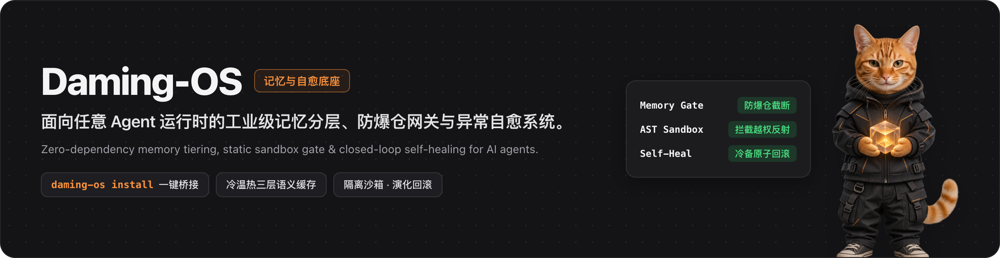
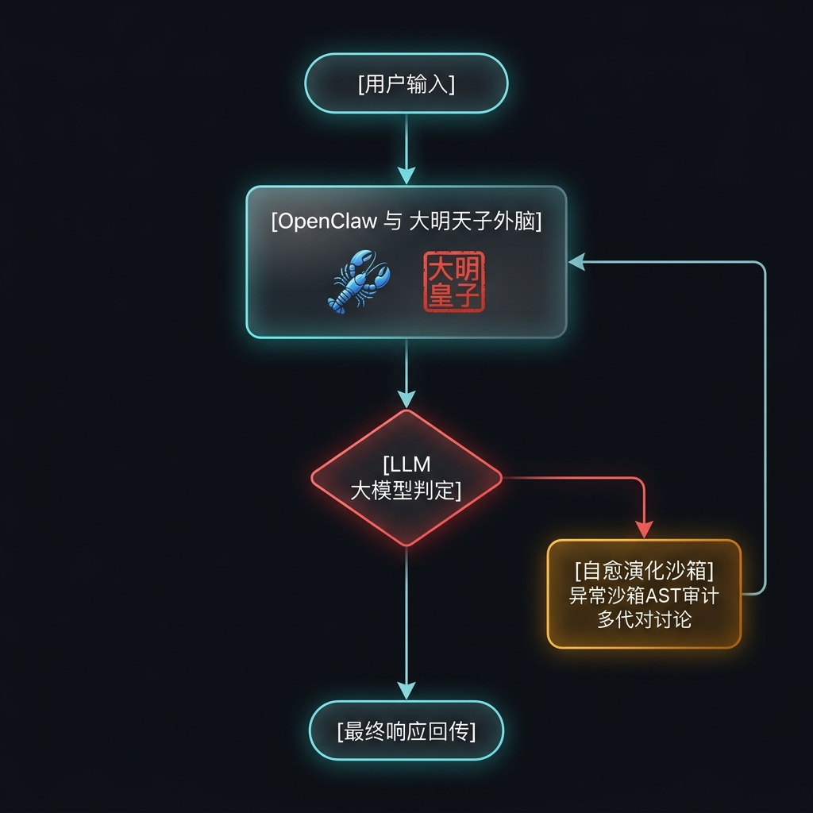

<picture>
  <source media="(prefers-color-scheme: dark)" srcset="assets/banner-dark.png">
  <source media="(prefers-color-scheme: light)" srcset="assets/banner-light.png">
  
</picture>

<div align="center">

<p>
  <a href="README.md"></a>
  <a href="README.zh-CN.md"></a>
  <a href="setup.py"></a>
  <a href="setup.py"></a>
  <a href="LICENSE"></a>
</p>

<p>
  <b>支持接入</b>&nbsp;
  
  
  
  
  
</p>

[30 秒一键接入](#30-秒一键接入) · [闭环架构图](#系统架构与闭环流转) · [通用接入方式](#通用-agent-接入方式) · [English](README.md)

</div>

---

把自主智能体直接放到生产或高权限环境里「裸奔」，通常会撞上三个致命问题：

- **上下文爆仓烧钱**：对话与工具日志逐轮堆积，Token 账单指数级飙升，直至撞上上下文上限崩溃。
- **自演化越权风险**：缺乏静态审计就直接执行 Agent 生成的代码或补丁，极易触发危险导入或文件系统越权修改。
- **报错死循环风暴**：运行异常后陷入盲目重试与自我纠错死循环，短时间内榨干全部 API 配额。

**Daming-OS** 是面向任意智能体运行时的**工业级记忆分层与异常自愈底座**。核心包**零第三方依赖**，不绑定 OpenClaw 或任何特定框架——只要宿主接入标准生命周期、审批与部署契约，即可立刻获得冷温热三层记忆、防爆仓截断网关、隔离沙箱静态安检与支持冷备回滚的自愈演化闭环。

---

## 30 秒一键接入

核心包无第三方运行时依赖（`Python >= 3.9`），一条命令即可在现有 Agent 项目内生成隔离桥接层：

```bash
pip install "daming-os @ git+https://github.com/dylanma8232-art/Daming-OS.git"
daming-os install --host-dir .
```

安装器会自动生成 `daming_bootstrap.py`、隔离的 `.daming/` 状态目录、宿主专属稳定 Agent ID 以及防止隐私记忆误提交的 `.daming/.gitignore`，并现场跑通一次**「写入 → 整理 → 召回」**冒烟自检，全程不触碰宿主原有的提示词与密钥文件。

在宿主代码中三行接入：

```python
from daming_bootstrap import daming

session_id = daming.new_session_id()
ctx = daming.before_turn("检索上次确认的架构约束", session_id=session_id)
# 执行宿主自己的模型与工具调用，可按需注入 ctx["daming_memories"]
daming.after_turn("检索上次确认的架构约束", "已按约束执行完毕。", session_id=session_id)
```

如果宿主支持统一的 Hook 注册器，一行即可挂载完整生命周期（`before_turn` / `after_turn` / `error`）：

```python
daming.install_hooks(agent.register_hook)
```

---

## 系统架构与闭环流转

Daming-OS 的记忆系统与成长自愈系统通过事件总线与结构化日志通道深度耦合，形成「执行 → 捕获 → 审计 → 自愈 → 沉淀」闭环：

<p align="center">
  
</p>

| 核心模块 | 解决的裸奔风险 | Daming-OS 的工程机制 |
|---|---|---|
| **冷温热三层记忆与防爆仓网关** | 上下文膨胀、检索慢 | 文件锁 + 两级热缓存微秒级响应；密集向量与全文稀疏混合检索；写入清洗标签、超限自适应精简与物理截断 |
| **隔离沙箱与静态安检门** | 越权执行、高危反射修改 | 隔离沙箱内执行编译检查、AST 静态分析与冒烟测试，默认拦截危险导入与文件系统反射篡改 |
| **异常捕获与多智能体博弈自愈** | 报错死循环、重复踩坑 | 指数衰退滑动窗口计算成长分，按需触发红蓝白三方博弈生成修复补丁，并将报错沉淀为负反馈记忆 |
| **可恢复演化状态机** | 自更新把线上改崩 | 严格遵循 `proposed → validated → approved → deployed → verified/rolled_back`，部署前自动冷备、支持原子回滚 |
| **多租户与敏感凭据治理** | 跨会话串味、密钥泄露 | 写入前自动脱敏凭据、强制绑定 `tenant / agent / session` 作用域，默认拒绝读取旧版无作用域数据 |

---

## 通用 Agent 接入方式

### 1. 显式适配器接入（`DamingAdapter`）

```python
from daming_os import AgentContext, DamingAdapter

adapter = DamingAdapter()
context = AgentContext(
    agent_id="research-agent",
    session_id="session-42",
    tenant_id="team-a",
    metadata={"trace_id": "trace-123"},
)
memories = adapter.before_turn("检查发布前阻断项", context)
# 宿主执行模型推理与工具调用
adapter.after_turn("检查发布前阻断项", "已完成核验。", context)
```

配合 `EvolutionWorkflow` 可自由注入宿主自定义的 `validator`、`approvals`、`deployer` 与 `verifier`，不把任何聊天平台或部署工具硬编码进底座。

### 2. 独立运行时与后台维护调度（`DamingRuntime`）

```python
from daming_os import DamingRuntime

runtime = DamingRuntime("./.daming", skill_dirs=["./skills"])
runtime.hooks.install(agent.register_hook)
runtime.start_scheduler(poll_seconds=30)  # 可选：仅常驻守护进程需要开启
```

默认后台维护克制且可预期：
- **`daily-maintenance`（每日 02:30）**：深度睡眠记忆整合、健康巡检与超时审批提醒（24 小时冷却）。
- **`weekly-governance`（每周日 23:30）**：保留期清理与经验生命周期流转（`pending → verified → deprecated`，仅已验证经验可蒸馏为待审技能候选）。
- **`daily-digest` 与 `watchdog`**：默认关闭，按需显式开启。

### 3. 按需接入语义向量检索

仅在需要时安装可选扩展（`[vector]`、`[llm]`、`[full]`），支持任意 OpenAI 兼容的 Embedding 接口：

```python
from daming_os import OpenAICompatibleEmbeddingProvider
from daming_os.memory.core import MemorySystem

embeddings = OpenAICompatibleEmbeddingProvider(
    model="your-embedding-model",
    base_url="https://your-endpoint/v1",
)
memory = MemorySystem(embedding_provider=embeddings)
```

### 4. 本地命令行审批与体检

无需依赖外部聊天机器人即可在本地完成一次性 OTP 审批（口令仅终端显示一次、永不落日志）与状态诊断：

```bash
daming-os status --dir ./.daming
daming-os doctor --dir ./.daming
daming-os approvals --dir ./.daming list
daming-os approvals --dir ./.daming issue <proposal-id>
daming-os approvals --dir ./.daming approve <proposal-id> <otp>
```

---

## 安全与可用性原则

Daming-OS 对宿主可用性默认采用 **Fail-Open**（存储或配置异常通过 `daming_degraded` 标记上报，绝不拖垮宿主主流程；高敏场景可传 `DamingPlugin(strict=True)` 切换为严格阻断），对代码演化默认采用 **Fail-Closed**（高危系统调用与未授权变更一律拦截）。

---

## 关于作者

作者：**[Dylan.ma](https://github.com/dylanma8232-art)** · [查看主页更多开源工具与实验项目 →](https://github.com/dylanma8232-art?tab=repositories)

本项目基于 [CC BY-NC-SA 4.0](LICENSE) 协议开源。
