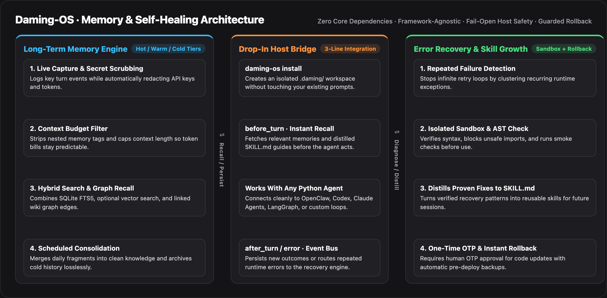

<div align="center">

# Daming-OS

**Zero-core-dependency Memory 3.0 & Self-Healing 2.0 runtime foundation for any Python AI agent**

<p>
  <a href="README.md"></a>
  <a href="README_EN.md"></a>
  <a href="https://github.com/dylanma8232-art/Daming-OS/releases/latest"></a>
  <a href="setup.py"></a>
  <a href="setup.py"></a>
  <a href="LICENSE"></a>
</p>

<p>
  <b>Host-Neutral Integration</b>&nbsp;
  
  
  
  
  
</p>

[Why Daming-OS](#why-daming-os) · [30-Second Quickstart](#30-second-quickstart) · [Dual-Loop Architecture](#dual-loop-architecture) · [Integration Modes](#integration-modes) · [CLI Operations](#cli-operations) · [Changelog](CHANGELOG.md)

</div>

---

## Why Daming-OS

Running autonomous agents without an operational foundation leads to three predictable production failures:

- **Context bloat & runaway token bills**: Multi-turn logs and recursive memory tags pile up until API budgets spike or context windows overflow.
- **Unsafe self-modification**: Executing agent-synthesized patches without isolated static auditing exposes the host to dangerous imports and reflection writes.
- **Infinite crash loops**: Runtime exceptions trap the agent in blind retry loops without persisting negative-feedback guardrails or distilling proven fixes.

**`Daming-OS`** is a **zero-core-dependency, framework-agnostic memory and self-healing foundation**. Through standard lifecycle hooks (`before_turn`, `after_turn`, `error`), any Python agent can attach **Hot/Warm/Glacier Memory 3.0 + Wiki Graph Activation** alongside **AST Sandbox Auditing + Cold-Backup Self-Healing 2.0** in under a minute.

---

## 30-Second Quickstart

The core package uses only the Python standard library (`Python >= 3.9`). Install and scaffold an isolated bridge inside your existing agent directory:

```bash
pip install "daming-os @ git+https://github.com/dylanma8232-art/Daming-OS.git"
daming-os install --host-dir .
```

Without touching your host's prompts or secret files, `daming-os install`:
1. Creates an isolated `.daming/` state workspace and `.daming/.gitignore`;
2. Assigns a stable host-bound `agent_id`;
3. Generates the lazy fail-open bridge `daming_bootstrap.py`;
4. Runs an end-to-end **capture → consolidate → recall** smoke test.

Wire it into your agent loop in **three lines**:

```python
from daming_bootstrap import daming

session_id = daming.new_session_id()
ctx = daming.before_turn("Check our release freeze rules", session_id=session_id)
# Run your host model & tools here, optionally injecting ctx["daming_memories"]
daming.after_turn("Check our release freeze rules", "Rules verified.", session_id=session_id)
```

Or mount all lifecycle hooks (`before_turn`, `after_turn`, `error`) in one call:

```python
daming.install_hooks(agent.register_hook)
```

---

## Dual-Loop Architecture

Memory 3.0 and Growth/Self-Healing 2.0 share an internal event bus and audit ledger — verified fixes immediately write back into Warm Memory, the Wiki knowledge graph, and standard lazy-loaded `SKILL.md` packages:

<picture>
  <source media="(prefers-color-scheme: dark)" srcset="assets/architecture-en-dark.png">
  <source media="(prefers-color-scheme: light)" srcset="assets/architecture-en-light.png">
  
</picture>

| Subsystem | Core Module | Engineering Guarantees |
|---|---|---|
| **Memory System 3.0** | **Hot → Warm → Glacier Tiering** | File-locked two-level hot cache; SQLite FTS5 sparse search + optional dense vectors; lossless Glacier cold archiving & restore |
| **Knowledge Graph** | **Weighted `wiki_edges` Activation** | Dynamic spreading activation (`depends_on=1.0`, `causes=0.9`, `extends=0.8`); pull-merge-push Bitable two-way sync |
| **Context Budget Gateway** | **Anti-Nesting & Compaction** | Dynamically strips recursive `<MemoryHint>` tags, compacts 3-turn user intent windows, and enforces hard character caps |
| **Static Safety Gate** | **Isolated Sandbox & AST Audit** | Syntax compilation, static AST inspection, and smoke tests block dangerous imports and filesystem reflection mutations |
| **Growth & Self-Healing 2.0** | **5-Class GEP + Tri-Party Heal** | Exponentially decayed failure scoring triggers Red/Blue/White patch synthesis and distills verified patterns into `SKILL.md` |
| **Recoverable Evolution** | **One-Time OTP + Atomic Rollback** | Strict `proposed → validated → approved → deployed → verified/rolled_back` workflow with automatic pre-deploy cold backups |
| **Tenant & Secret Governance** | **Scoping & Secret Redaction** | Scrubs credentials before persistence and enforces `tenant / agent / session` isolation boundaries |

---

## Integration Modes

### 1. Explicit Multi-Tenant Adapter (`DamingAdapter`)

```python
from daming_os import AgentContext, DamingAdapter

adapter = DamingAdapter()
context = AgentContext(
    agent_id="release-auditor",
    session_id="session-42",
    tenant_id="team-core",
    metadata={"trace_id": "req-9812"},
)

memories = adapter.before_turn("Verify database rollback plan", context)
# Run your host model and tool pipeline
adapter.after_turn("Verify database rollback plan", "Rollback plan verified.", context)
```

### 2. Standalone Daemon Runtime & Scheduler (`DamingRuntime`)

```python
from daming_os import DamingRuntime

runtime = DamingRuntime("./.daming", skill_dirs=["./skills"])
runtime.hooks.install(agent.register_hook)
runtime.start_scheduler(poll_seconds=30)  # Optional for long-lived daemon hosts
```

Built-in maintenance stays lightweight and deterministic:
- **`daily-maintenance` (02:30)**: Deep-sleep consolidation, anomaly checks, and overdue approval reminders (24h cooldown).
- **`weekly-governance` (Sun 23:30)**: Retention cleanup and experience lifecycle transitions (`pending → verified → deprecated`).
- **`daily-digest` & `watchdog`**: Disabled by default; opt in via `daming-os.json`.

### 3. Optional Vector & LLM Extras

Keep core installs dependency-free and add optional extras only when needed:

```bash
pip install "daming-os[vector] @ git+https://github.com/dylanma8232-art/Daming-OS.git"  # LanceDB vector store
pip install "daming-os[llm] @ git+https://github.com/dylanma8232-art/Daming-OS.git"     # LiteLLM integration
pip install "daming-os[full] @ git+https://github.com/dylanma8232-art/Daming-OS.git"    # All optional extras
```

Connect any OpenAI-compatible embedding endpoint:

```python
from daming_os import OpenAICompatibleEmbeddingProvider
from daming_os.memory.core import MemorySystem

embeddings = OpenAICompatibleEmbeddingProvider(
    model="text-embedding-3-small",
    base_url="https://your-openai-compatible-endpoint/v1",
)
memory = MemorySystem(embedding_provider=embeddings)
```

---

## CLI Operations

Every CLI subcommand emits structured JSON for clean scripting and diagnostics:

| Command | Purpose |
|---|---|
| `daming-os install --host-dir .` | Scaffolds `.daming/`, `daming_bootstrap.py`, and runs end-to-end recall smoke verification |
| `daming-os init --dir ./.daming` | Initializes a standalone workspace (`generic` / `langgraph` / `openclaw` / `codex` presets) |
| `daming-os status --dir ./.daming` | Inspects workspace manifest, scheduler job states, and recent task runs |
| `daming-os doctor --dir ./.daming` | Runs storage, index integrity, and configuration drift diagnostics |
| `daming-os maintain --dir ./.daming --consolidate` | Runs portable memory review and Hot-to-Warm consolidation |
| `daming-os migrate --dir ./.daming` | Migrates legacy memory workspaces safely |
| `daming-os approvals --dir ./.daming list / show <id>` | Lists or inspects pending evolution & self-healing proposals |
| `daming-os approvals --dir ./.daming issue <id>` | Issues a one-time terminal OTP (never persisted to logs) |
| `daming-os approvals --dir ./.daming approve <id> <otp>` | Approves and advances a validated proposal with pre-deploy cold backup |

---

## Security Posture

- **Fail-Open on Host Availability**: Storage hiccups set `daming_degraded` and gracefully pass control back to your agent without crashing production traffic (`DamingPlugin(strict=True)` enables strict fail-closed mode).
- **Fail-Closed on Code Evolution**: Any self-modification lacking clean AST static checks, sandbox smoke validation, or one-time OTP approval is blocked by default.

---

## Author

Built by **[dylanma8232-art](https://github.com/dylanma8232-art)** · **[Visit profile for more open-source projects →](https://github.com/dylanma8232-art)**

Licensed under [CC BY-NC-SA 4.0](LICENSE). Contributions welcome — see [CONTRIBUTING.md](CONTRIBUTING.md).
